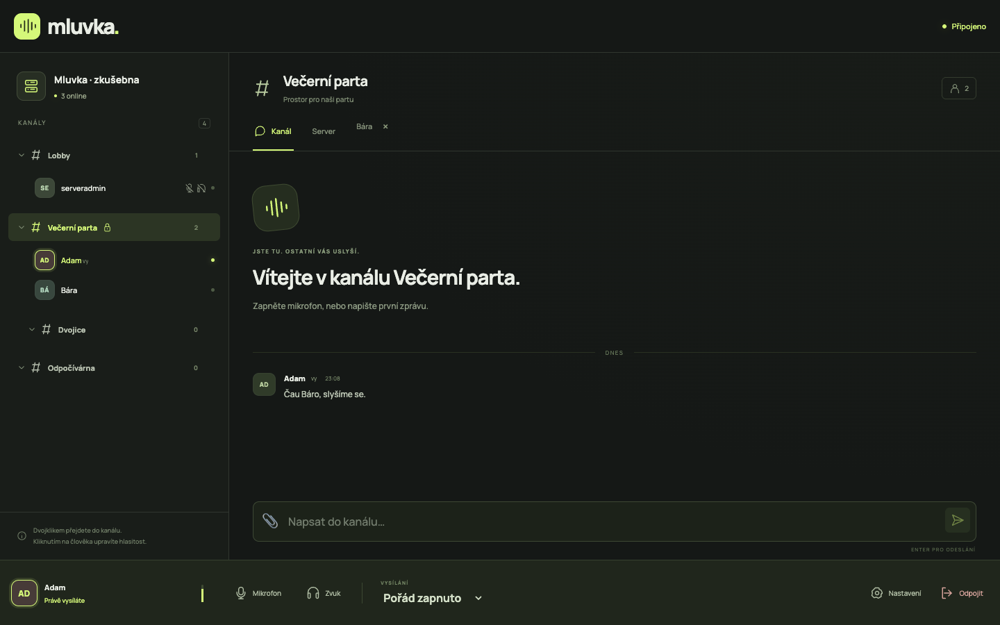

# Mluvka

Český webový hlasový klient pro TeamSpeak. Přezdívka, adresa, případně heslo a jste mezi
ostatními. Backend zastupuje každého uživatele samostatným TS3 připojením. Jeden kontejner,
jeden HTTP port, žádná databáze aplikace.



## Co umí

Strom kanálů s podkanály a živými změnami, přesuny včetně hesla, PTT s nastavitelnou klávesou
a dotykovým tlačítkem, hlasovou aktivaci a trvalé vysílání. Mute mikrofonu a deafen jsou vidět
na TS. Zařízení, vstupní zesílení, hlavní i lokální hlasitost 0–200 %, lokální mute podle UID,
lokální test mikrofonu, serverový, kanálový a soukromý chat, upozornění na poke a vypnutelné
pípnutí při příchodu/odchodu z kanálu. Mobil má záložky kanálů a chatu.

TS identita (úroveň ≥8) zůstává v prohlížeči, lze ji exportovat/importovat jako text. Údaje
připojení i hesla se pamatují podle voleb na formuláři (výchozí zapnuté).

## Na mobilu / instalace na plochu

- **iPhone:** otevřete Mluvku v **Safari → Sdílet → Přidat na plochu**. Nápovědu na přihlášení
  lze zavřít; zavření se pamatuje. Ikona spouští samostatné okno bez adresního řádku.
- **Android:** otevřete v **Chrome → Nainstalovat aplikaci** nebo použijte **Přidat na plochu**
  na přihlášení, jakmile Chrome nabídne instalaci. Vyžaduje HTTPS (lokálně stačí localhost).
- Po spuštění se Mluvka připojí na uložený server a do posledního úspěšně navštíveného kanálu.
  Připojování lze zrušit. **Připojit automaticky po spuštění** vypnete na přihlašovacím formuláři;
  změna se ukládá hned. Po ručním **Odpojit** se tentýž tab nepřipojí ani po reloadu, nové okno ano.
- **Zapamatovat připojení**, **Zapamatovat i hesla na tomto zařízení** a automatické připojení
  jsou ve výchozím stavu zapnuté. V `localStorage` tohoto zařízení a originu jsou údaje serveru,
  přezdívka, cesta posledního kanálu, volby, nastavení zvuku, hlasitosti lidí a TS identita (stejné UID).
  Heslo serveru i kanálu se ukládá **jen při zapnuté volbě hesel**. Vypnutí zapamatování uložené
  přihlášení odstraní; identitu zachová. Hesla nejsou šifrovaná. Na sdíleném zařízení volby vypněte.
  Příznak ručního odpojení je v `sessionStorage`; vypnutá hesla zůstávají pouze v paměti probíhajícího
  spuštění, aby bylo možné obnovit výpadek. Chat se neukládá.
- Při ztrátě sítě se opakují pokusy po 1, 2, 4, 8 a dále 15 sekundách, pouze v popředí.
  Návrat do aplikace nebo připojení sítě vyvolá okamžitý pokus. Špatné heslo, ban, nepovolený server
  a neplatné údaje vrátí formulář bez dalších automatických pokusů. Po tvrdém pádu backendu může
  obnovení čekat na timeout starého klienta na TS serveru; identita ani přezdívka se tím nemění.
- **Klepni pro zapnutí zvuku** odblokuje zvuk po automatickém připojení nebo po přerušení hovorem.
  TS spojení běží i při zablokovaném zvuku. Odpojený mikrofon aplikace zkusí znovu otevřít;
  při zmizení sluchátek použije výchozí vstup. Potlačení ozvěny je zapnuté.
- Držte **Drž a mluv** pro PTT; puštění či zrušení dotyku vysílání zastaví. Podržení člověka
  půl sekundy otevře spodní panel s hlasitostí, lokálním ztlumením a zprávou. Zavře ho klepnutí mimo,
  křížek nebo tažení panelu dolů. V Nastavení lze zapnout **Nezhasínat displej** (výchozí vypnuto).
- Na mobilu vede poslech přes `<audio>` a `MediaStreamAudioDestinationNode`; Media Session ukazuje
  kanál a play/pause zapne/ztlumí mikrofon. Desktop používá přímý výstup kvůli latenci. Pokud mobilní
  přehrávač cestu odmítne jako nepodporovanou, použije se také přímý výstup. Zákaz autoplay vyžaduje
  klepnutí. Vliv na latenci konkrétních sluchátek není změřený.
- **iOS při zamčeném displeji / na pozadí může uspat webovou aplikaci:** zvuk se přeruší,
  po návratu Mluvka obnoví zvuk a sama se připojí. Android může omezit běh úsporným režimem.
  Screen Wake Lock ani Media Session nezaručují nepřerušený hovor. **Fyzický iPhone/Android nebyl ověřen**;
  E2E používá Chromium s emulací iPhonu a Pixelu, nikoli skutečný Safari/OS, Bluetooth, Siri nebo telefonní hovor.

Skořápka aplikace je dostupná offline; TS hovor potřebuje síť. Index se načítá nejdřív ze sítě,
verzované assety z cache. Aktualizace SW čeká na odpojení všech otevřených oken, neobnovuje stránku během hovoru.
Ikony vznikají z `frontend/public/favicon.svg`: `node scripts/ikony.mjs` (Playwright Chromium/Chrome,
volitelně `CHROME_PATH`). PNG včetně neprůhledné Apple ikony jsou součástí repa; motiv maskable je uvnitř
bezpečné středové oblasti 80 %.

## Lokální spuštění

Potřebujete Rust **1.99**, Node **26**, npm, CMake, pkg-config a Opus. Na macOS:

```sh
brew install rust cmake opus pkg-config
npm ci
npm run build
cargo build --release --locked
./target/release/mluvka
```

Na Debianu/Ubuntu jsou stavební závislosti `build-essential cmake pkg-config libopus-dev`.
Otevřete <http://localhost:3000>, `/healthz` vrací `ok`. Mikrofon vyžaduje HTTPS nebo localhost
a oprávnění prohlížeče. Produkční frontend servíruje axum ze složky `dist/`.

Vývoj ve dvou terminálech:

```sh
cargo run
```

```sh
npm run dev
```

Vite vypíše adresu a přesměruje `/ws` i `/healthz` na backend na portu 3000.

## Nastavení provozu

| Proměnná | Výchozí | Význam |
| --- | --- | --- |
| `PORT` | `3000` | Jediný HTTP/WS port. |
| `ALLOWED_SERVERS` | prázdné | Čárkami oddělené `host[:port]`. Prázdné (výchozí) povolí libovolný server — tak se Mluvka zatím nasazuje. Omezení lze kdykoliv zapnout. |
| `MAX_SESSIONS` | `20` | Současná spojení včetně WS čekajících na přihlášení. |
| `RUST_LOG` | `mluvka=info` | Úroveň logů aplikace. TS paketové logy jsou kvůli přihlašovacím údajům vždy vypnuté. |
| `STATIC_DIR` | `dist` | Cesta k frontendu. |

Ilustrační příklad: `ALLOWED_SERVERS=ts.example.org:9987,voice.example.net:9990`.
Port se porovnává přesně, hostname bez rozlišení velikosti písmen. `host` znamená port 9987.
IPv6 zadávejte jako `[adresa]:port`. TS nickname a DNS SRV lookup nejsou podporované;
z více DNS adres se použije první.

Hesla ani identity se na backendu neukládají a nelogují. Limity chrání počty relací, velikosti
zpráv, tempo vstupu i síťové čekání. Každý návštěvník obsadí TS slot a komunikuje z IP kontejneru;
TS správce může sdílenou IP omezit. Používejte povolené servery, kterým důvěřujete.

## Nasazení na Easypanel

Image se **nestaví na Easypanelu** (Rust build tam padal na paměti). Staví ho GitHub Actions
z `Dockerfile.build` a při každém pushi do `main` ho publikuje jako `ghcr.io/pawlig/mluvka:latest`
(a `:sha-<commit>`), jen `linux/amd64`. Easypanel hotový image jen stáhne.

1. Přidejte **App** a jako zdroj zvolte **Docker Image** `ghcr.io/pawlig/mluvka:latest`
   (image je veřejný, přihlášení k registru netřeba).
   *Jde i zdroj GitHub `pawlig/mluvka` + build Dockerfile — kořenový `Dockerfile` obsahuje jen
   `FROM ghcr.io/pawlig/mluvka:latest`, takže se nic nepřekládá. Automatické nasazení po pushi ale pak
   vypněte, jinak Easypanel stáhne image dřív, než ho CI stihne postavit.*
2. Nastavte port **3000**. Kontejner běží jako UID 10001, nepotřebuje volume ani databázi.
3. Proměnné jsou volitelné: `ALLOWED_SERVERS` zatím nenastavujte (povolí se všechny servery), případně `MAX_SESSIONS` a `RUST_LOG`.
4. Přidejte doménu s **HTTPS** a nasaďte. WSS jede na stejné doméně přes `/ws`; Traefik předává upgrade.
5. **Automatické nasazení po buildu:** v Easypanelu zkopírujte *Deploy Webhook* aplikace a uložte ho
   na GitHubu jako secret `EASYPANEL_DEPLOY_WEBHOOK`
   (`gh secret set EASYPANEL_DEPLOY_WEBHOOK --repo pawlig/mluvka`). CI ho zavolá až po publikaci image.
   Bez secretu se nasazuje ručně tlačítkem Deploy.
6. Ověřte `/healthz`, připojení a hlas dvou relací. Host musí dosáhnout na **odchozí UDP port TS**
   (obvykle 9987). Příchozí UDP pro aplikaci se nepublikuje.

`Dockerfile.build` staví frontend v Node, backend v Rustu a kopíruje je do ne-root `debian:bookworm-slim`.
CI na PR jen staví a ověří HTTP i UID; na push do `main` navíc publikuje do GHCR:
[běhy Docker CI](https://github.com/pawlig/mluvka/actions/workflows/docker.yml).
Lokální build celého image: `docker build -f Dockerfile.build -t mluvka .`

## Ověření

```sh
cargo build --release --locked
cargo clippy -- -D warnings
cargo test
npm run typecheck
npm run build
npm run e2e
```

E2E používá Playwright s vlastním headless Chrome, dvěma prázdnými kontexty a falešným mikrofonem.
Na Macu použije `/Applications/Google Chrome.app/Contents/MacOS/Google Chrome`, jinde Playwright
Chromium (`npx playwright install chromium`). Cestu lze přepsat přes `CHROME_PATH`.
Spojitý testovací tón putuje skutečným workletem přes PCM, Opus a TS. Hesla testů vznikají
náhodně v paměti a nejsou v repu.

Lokální TS3 stáhněte před testem:

```sh
mkdir -p tmp-ts3
curl --fail --location https://files.teamspeak-services.com/releases/server/3.13.7/teamspeak3-server_mac-3.13.7.zip -o tmp-ts3/server.zip
unzip -q tmp-ts3/server.zip -d tmp-ts3
```

TS3 je x86_64 a na Apple Silicon vyžaduje Rosettu. Skript spustí TS3 s přijatou licencí,
backend i prohlížeč a na konci je ukončí. Potřebuje volné porty 9987/UDP, 10011/TCP,
30033/TCP a 3000/TCP. `TS3_DIR` může ukazovat i na rozbalený Linux TS3 server.
Porty jdou přepsat proměnnými `E2E_PORT`, `TS3_VOICE_PORT`, `TS3_QUERY_PORT` a `TS3_FT_PORT` — pro souběžné běhy
stačí každému dát vlastní porty a vlastní kopii TS3 (`TS3_DIR`, bez `ts3server.sqlitedb*`, ať se virtuální server
založí na nových portech).
`E2E_URL` dovoluje připojit již běžící backend; úplná sada včetně restartu vyžaduje lokální backend bez této volby.

**Používejte jen vyhrazený testovací TS server:** skript přenastaví jeho jméno a heslo,
odstraní ostatní kanály a vytvoří testovací strom. Nepouštějte ho nad osobním TS serverem.

Testy ověřují také seznam povolených serverů, limit relací/zpráv, kontrolu Origin, obsazenou
přezdívku a živé změny kanálů. Pokrývají chybná hesla, dvě relace, přesun s heslem, všechny tři chaty, nenulové audio,
lokální mute (RMS ~0), mikrofon/deafen, test mikrofonu, PTT, hlasovou aktivaci, stejné UID po
obnovení a TS odpojení po zavření prohlížeče. Výsledky: `docs/e2e-vysledky.json`.
Nové kontroly pokrývají PWA/HTTP cache, instalovatelnost CDP, offline skořápku, automatické připojení,
trvalou chybu bez opakování, sessionStorage, výpadek sítě/restart a dotyk iPhone/Pixel. Skutečný audio tok
běží také při AudioContext 44,1 kHz; `node e2e/resampling.mjs` samostatně ověří délky rámců workletu.
Screenshoty připojeného klienta: `docs/screenshots/`. Audio statistiky: `window.__mluvkaStats`.

## Proč takhle

Prohlížeč neumí TS3 UDP protokol a kryptografii. Rust používá
[ReSpeak/tsclientlib](https://github.com/ReSpeak/tsclientlib) s pevným rev
`ee3bc6f45a7137db7793ba5593a321df400d53e5`, ostatní závislosti fixuje Cargo.lock.
`AudioHandler` dekóduje, bufferuje a mixuje hlasy. Vstupní Opus má mono 48 kHz, 20 ms,
OpusVoice; frontend zpracovává zvuk v AudioWorkletu s 80ms přehrávacím bufferem.
Záložní C# varianta nebyla potřeba. [Úplný WS protokol](docs/protokol.md).

## Známá omezení

- PCM po WS spotřebuje asi **770 kb/s v každém směru** při vysílání; příjem teče i s tichem.
  TCP a dva jitter buffery přidávají latenci proti nativnímu klientovi.
- Výběr výstupu závisí na `AudioContext.setSinkId` a oprávnění prohlížeče. Kde chybí
  (např. některé verze Safari/Firefox), volba se skryje s poznámkou o systémovém výstupu.
- PTT funguje při aktivní stránce a mimo textová pole. Mobil může na pozadí či při zhasnutí
  displeje přerušit audio i spojení.
- Příjem podporuje **OpusVoice a OpusMusic**, nikoli staré kanály Speex/CELT. Na TS nastavte
  Opus; aplikace kodek cizího kanálu nemění.
- Pohyb, odběr všech kanálů a serverový chat podléhají TS oprávněním. Nepřístupní klienti
  nemusí být vidět, odmítnutí se zobrazí česky.
- Po síťovém výpadku se spojení obnovuje automaticky. Po novém spuštění bez uložených hesel je nutné hesla doplnit.
- Identita a případně zapamatovaná hesla jsou v localStorage daného originu. Export obsahuje
  privátní klíč. Zálohujte ho soukromě; vymazání dat webu bez zálohy znamená novou identitu.
- Testováno proti TS3 3.13.7. Konkrétní TS6 server a fyzická zvuková zařízení závisí na konfiguraci.
- Bez administrace serveru, souborů, avatarů a whisperu.

Mluvka není oficiální produkt TeamSpeak. TS3 server a jeho licence nejsou součástí repozitáře.
